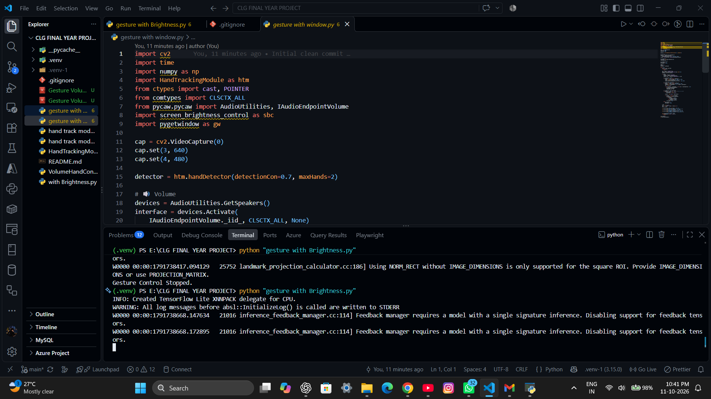
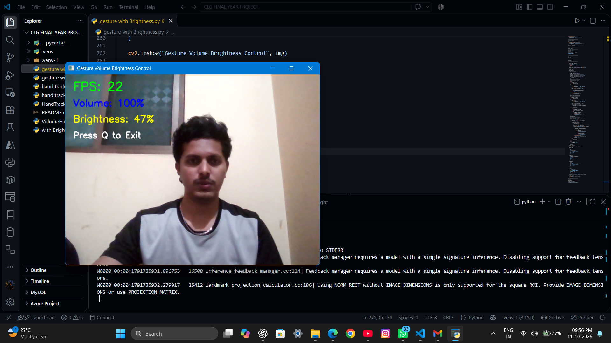
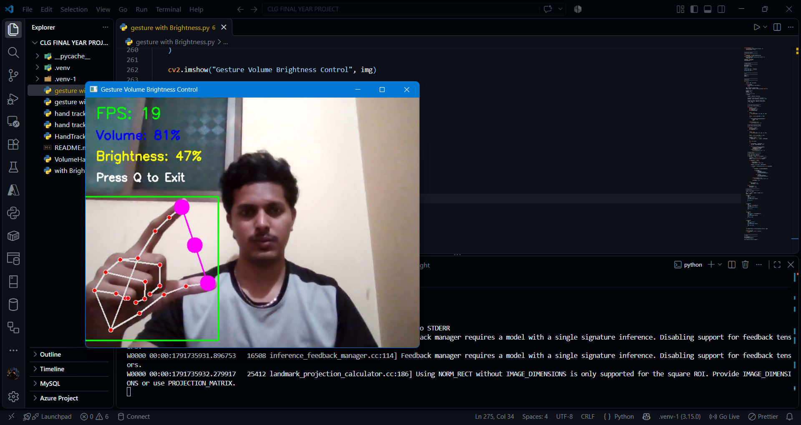

# ✋ Hand Gesture Volume & Brightness Control

<p align="center">
  <b>Control System Volume and Screen Brightness Using Hand Gestures</b>
  <br>
  A Computer Vision Project Built with Python, OpenCV and MediaPipe.
</p>

<p align="center">
  
  
  
</p>

---

## 🎓 Academic Project

- **Project Type:** College Final-Year Project
- **Degree:** B.Tech – Computer Science and Business Systems (CSBS)
- **Developer:** Yash Patil

## 📌 About the Project

Hand Gesture Volume & Brightness Control is a Python-based computer vision application that allows users to control system volume and screen brightness using hand gestures.

The application uses a webcam to detect and track hand movements in real time. OpenCV and MediaPipe handle hand tracking, while Python libraries control system volume and screen brightness.

The main objective is to make computer interaction easier through touch-free hand gestures.

## ✨ Features

- 🔊 Control system volume using hand gestures
- 💡 Adjust screen brightness
- ✋ Real-time hand tracking using a webcam
- 🎯 Hand landmark detection using MediaPipe
- ⚡ Touch-free computer interaction
- 🖥️ Simple and user-friendly application

## 📸 Project Screenshots

### 🔊 Volume Control



### 💡 Brightness Control



### ✋ Hand Gesture Detection



## 🛠️ Technologies Used

| Technology | Purpose |
|---|---|
| Python | Core programming language |
| OpenCV | Webcam access and image processing |
| MediaPipe | Hand detection and tracking |
| NumPy | Numerical calculations |
| Pycaw | System volume control |
| Screen Brightness Control | Screen brightness adjustment |
| PyGetWindow | Window management |

## 💻 System Requirements

- Python 3.10
- Windows operating system
- Webcam
- Required Python libraries

## ⚙️ Installation and Setup

### Step 1: Clone the Repository

```bash
git clone https://github.com/yashpatil9981/Hand-Gesture-Volume-Brightness-Control.git
```

### Step 2: Open the Project Folder

```bash
cd Hand-Gesture-Volume-Brightness-Control
```

### Step 3: Install the Required Libraries

```bash
pip install opencv-python mediapipe numpy pycaw comtypes screen-brightness-control pygetwindow
```

### Step 4: Run the Application

```bash
python "gesture with Brightness.py"
```

## 🎮 How to Use

1. Install Python and the required libraries.
2. Connect or enable your webcam.
3. Run the Python application.
4. Show your hand in front of the webcam.
5. Perform the supported hand gestures.
6. Control system volume and screen brightness in real time.

## 📂 Project Structure

```text
Hand-Gesture-Volume-Brightness-Control/
│
├── gesture with Brightness.py
├── HandTrackingModule.py
├── phto1.png
├── phto2.png
├── phto3.png
├── README.md
└── .gitignore
```

## 🎯 Project Objectives

- Develop a touch-free computer control system.
- Implement real-time hand tracking using computer vision.
- Control volume and brightness through hand gestures.
- Explore practical applications of Python and MediaPipe.

## 📚 Learning Outcomes

- Python programming
- Computer vision using OpenCV
- Hand tracking using MediaPipe
- Real-time image processing
- Integration of Python libraries with system controls

## ⚠️ Limitations

- A working webcam is required.
- Performance may depend on lighting conditions.
- Some features are designed specifically for Windows.
- Required libraries must be installed before running the application.

## 👨‍💻 Author

**Yash Patil**

B.Tech – Computer Science and Business Systems (CSBS)

[GitHub Profile](https://github.com/yashpatil9981)

**Project Repository:**  
[Hand Gesture Volume & Brightness Control](https://github.com/yashpatil9981/Hand-Gesture-Volume-Brightness-Control)

---

<p align="center">
  ⭐ If you find this project interesting, consider giving it a star!
  <br>
  Made with ❤️ using Python
</p>
